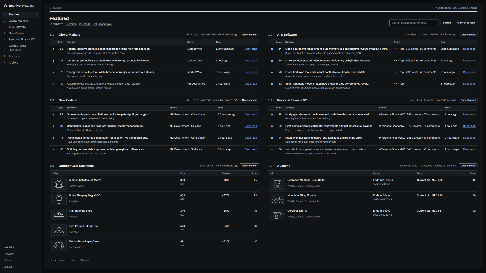
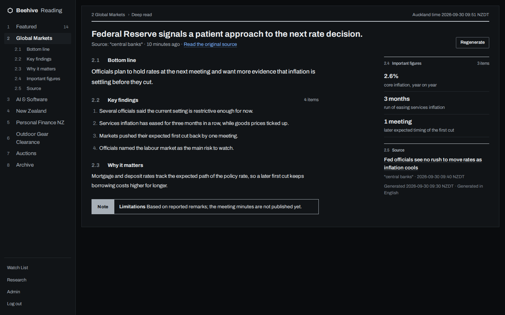

# User guide

How to set up and use Beehive once it is running. To install it, see the
[quick start](../README.md#quick-start). For every setting and command, see
[Configuration](configuration.md).

You do everything in the web app. Sign in at `/admin` to change anything. The screenshots use
made-up data.

## Create a channel

A channel collects items about one topic from the sources you pick, and the AI scores each new item
against what you tell it you care about.

1. In the admin, open **Channels** and select **New channel**. Pick a **Channel type**, give it a
   name, then **Save and continue**. The type cannot change later.
2. In **Sources**, select **Add source**. Fill in its connection details, use **Test connection**
   to inspect a sample, then save.
3. In **Organization rules**, describe what to keep and skip under **What to focus on**. Set
   **Minimum AI score** and **Highlights per channel**, then **Save and continue**.
4. In **Email**, choose **Website only**, join an existing group, or create a daily email.
5. In **Review and start**, check the arrangement and fetch schedule. Open **Settings** to choose
   a fixed interval or a daily local time. Select **Start this channel** when ready.

Setup is saved as a draft. Its sources stay paused, and no content is collected until you select
**Start this channel**. Starting queues the first collection.

Each channel has five task tabs: **Overview**, **Sources**, **Organization rules**, **Email**, and
**Settings**. They remain available on a phone. Each task saves its own settings without replacing
unrelated settings. Unsaved edits are restored when you return in the same browser tab; save them
to make them permanent. If the saved configuration changed meanwhile, choose whether to restore
or discard the local draft.

## Choose a channel type

| Type | Use it for | What you get |
| --- | --- | --- |
| **Editorial** | News and discussion | Scored stories with one-line summaries, unread markers, votes and deep reads, on the home page, the channel page, the archive and in email |
| **Monitor** | Online store catalogues | Live listings with photos, prices and discounts; new items, price drops and restocks; search and filters; a history of listings that sold out or were removed. The best live listings show on the home page, and changes can go out by email |
| **Tracker** | Auctions and other listings with an end time | Lots ending soon and coming up, and the lots you watch. Good open lots show on the home page, new lots can go out by email, and a watched lot gets a reminder before it closes |

## Add sources

Each source works with one channel type, so **Add source** only offers the ones that fit.

| Source | What it reads | Channel type |
| --- | --- | --- |
| Reddit | Posts in a subreddit | Editorial |
| Google News | Results for a search | Editorial |
| RSS or Atom feed | Posts from any site or blog that publishes a feed | Editorial |
| Hacker News | Top, best, new, Ask HN or Show HN stories, or a search | Editorial |
| Reserve Bank of New Zealand | Official news | Editorial |
| New Zealand Government | Official news | Editorial |
| US Federal Reserve | Official news | Editorial |
| Shopify stores | A collection, such as a sale page | Monitor |
| Land & Sea | A listing page | Monitor |
| Designer clearance | Sale catalogues from THE OUTNET, Mytheresa, END. and YOOX | Monitor |
| All About Auctions | Upcoming auctions and their lots, with bids and RRP | Tracker |

For an RSS or Atom feed, paste the feed's URL or just the site's address. Beehive follows the
site's feed link, and names the source after the feed unless you give it a name.

Use **Test connection** while adding or editing a source. It tests the values currently in the
form without saving the source, collecting items, or changing its health history. Errors stay
beside the relevant field. Existing sources also have a **Test** action in **Sources**.
**Pause** stops collection without removing the source; it does not cancel pending emails or
watched-lot reminders.

## Change organization rules

Saving **What to focus on** changes future ranking, not existing scores or summaries.
**Fetch now** collects content and retries unscored items; it does not rewrite already-scored items.

1. Edit the rules and select **Preview 5 items** to compare results on up to five recent eligible
   items. The preview uses the draft rules and AI, but leaves saved rules, items and email state
   unchanged. The sample count shows how many results meet the draft score cutoff.
2. Select **Save current rules** beside the results, or save the rules form. Editing the draft
   after a preview marks that preview as out of date.
3. To update existing results, expand **Reprocess existing content**, confirm the scope, and start
   it. This uses saved rules on unread Editorial items or current Monitor and Tracker listings.
   Progress and cancellation are available on the same page.

Reprocessing preserves item identity, read state, votes, watches and source history. Items that
change while processing are skipped. Cancelling keeps results already applied.

The score cutoff filters current results and pending emails without another AI call. A cutoff of
`0` includes score-zero items. Raising it can exclude pending content; lowering it or reprocessing
does not resend delivered emails or restore deliveries previously excluded.

## Read your highlights

The home page, **Featured**, gives every channel a section: the top stories of each news channel,
the best live listings of each store monitor, and the good lots still open in each auction
tracker. It shows stories from the last three days. To change that, go to **Global settings** and
set the **Featured window**. The counts at the top open a ranked list of every featured story, which
you can filter to unread, read, or a score of 90 and above.

- A blue square marks a story you haven't read. Select the square to mark it read. Opening a
  story marks it read too.
- **Relevant** and **Not relevant** tell the AI what you like. It takes your votes into account
  when it scores new stories. **Not relevant** also marks the story read and opens a field for an
  optional reason.
- **Mark all as read** can be undone for 10 minutes from the note it leaves at the top of the page.
- Press `j` and `k` to move between stories, listings and lots, `o` to open one and `/` to search.
  When you're signed in, `m` marks a story read or unread, `+` and `-` rate it, and `w` watches a
  lot.
- A store channel opens as a gallery of photos, and an auction channel as a list. Switch between
  **List** and **Gallery** at the top right, and pick 24, 48 or 96 items a page. Beehive remembers
  both choices.
- The archive keeps every story, day by day. Search covers stories, listings and lots.

On a wide screen, channel sections sit side by side, and a long list splits into two columns. Each
column scrolls on its own, so you never scroll back up to reach the next one. Where sections sit
side by side, such as a news channel's top stories and the rest, select **Hide** on one and the
others take the full width. **Show** brings it back, and Beehive remembers the choice.

## Get a deep read

Select **Deep read** on a scored story. Beehive fetches the full article and writes a brief of
about 500 to 800 words: the bottom line, key findings, important figures, why it matters, and what
it could not check. When the brief is ready, the link turns into **Open brief**. If the article was
cut short or behind a paywall, the brief says so.

## Watch an auction lot

On a **Tracker** channel, select **Watch** on a lot. It joins your **Watch List**, and Beehive
emails you about an hour before the lot closes. If the auction pushes the closing time back, the
reminder moves with it. The Watch List shows each reminder's state and lets you retry one that
failed.

## Set up email digests

Sending email needs the email settings in [Configuration](configuration.md#environment-variables).
Without them, Beehive prints each email in the terminal instead.

1. Open a channel's **Email** tab to create a daily email or join an existing group. Use
   **Email groups** to manage a shared group, its members and more detailed schedules. A group can
   mix news, store and auction channels; a channel belongs to at most one group.
2. Set the recipient and **Delivery schedule**. The first or next due time updates before saving.
   A new interval-based group can be due at the next worker check, not after a full interval.
3. Select **Preview** to see the actual HTML email, with a plain-text alternative and counts
   explaining which content is included or excluded.
4. **Send test email** sends immediately to the displayed recipient. It uses the current digest
   when one exists, otherwise a diagnostic message. Preview and test sends neither consume pending
   content nor move the regular delivery checkpoint. With log-only delivery, no email is sent.

A group only sends when it has something new. A story that was already emailed isn't sent again,
even when its feed republishes it under a new link. Email goes to the group's own recipient if it
has one, otherwise to the **Default email address** at the top of **Email groups**. A channel's
**Failure alert email** gets that channel's failure alerts.

The displayed schedule is a due time, not a delivery guarantee. The worker sends at its next check
if eligible content exists. Delivery diagnostics distinguish current items, unscored items,
eligible updates, score exclusions, age limits, holds, caps and duplicates. A store's first
collection establishes a baseline, so current listings do not necessarily mean a pending email.

## Research a question

For a one-off question that doesn't belong in a channel, open **Research** and select **New
Research Session**. Beehive plans searches across Reddit, Google News, Hacker News and the official
feeds, and shows you the plan. It then collects evidence for up to 20 minutes and writes an answer
with numbered sources.

- Edit the searches before the next run. Removed searches keep their evidence.
- Each piece of evidence keeps its number, so a citation always points at the same item.
- Leave a piece of evidence out of the answer, or put it back, without deleting it.
- Ask follow-up questions in a chat that remembers earlier questions, even in long conversations.
- Beehive emails you when a run finishes, if email is set up.
- Archive a session to stop new runs and messages until you unarchive it. Delete it to remove it
  and everything it collected.

Research only uses those news sources: it can't browse any website you name. Only you can see
research sessions, after you sign in. [How it works](how-it-works.md#research-sessions) explains its
limits and how it handles fetched text.

## Undo a change

When you delete a channel, a source or an email group, or clear a channel's data, Beehive keeps a
copy for seven days. To bring it back, open **System**, find it under **Activity** and select
**Undo**.

## Check that everything works

The **System** page shows whether fetching, email, reminders and research are working, and lists
recent failures. Each channel shows when it last fetched and what went wrong. A source that fails
waits an hour before it tries again, and twice as long after each further failure, up to a day.
